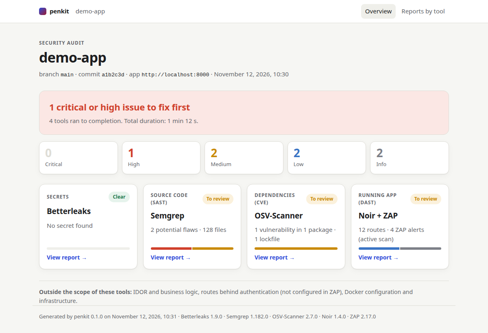

# penkit

Security audit of a web app, run from Claude Code, with four open source tools at pinned versions and a single HTML report.

| Tool | What it covers |
| --- | --- |
| **Betterleaks** 1.9.0 | Exposed secrets (API keys, tokens, passwords), in the files and the git history |
| **Semgrep** 1.182.0 | Flaws in the code (SAST): injections, XSS, SSRF, eval, weak crypto… |
| **OSV-Scanner** 2.7.0 | Known vulnerabilities (CVE) and malicious packages in the dependencies |
| **Noir** 1.4.0 + **ZAP** 2.17.0 | API routes mapped from the code, then attacked on the running app (DAST) |

Out of scope: IDOR and business logic, routes behind authentication, Docker configuration and infrastructure.

## Getting Started

Requirements: Linux x86_64 or arm64, Python 3.11+, git, Docker, pipx, `~/.local/bin` in the PATH.

1. **Download and install** (once per machine): installs the `penkit` command and the tools at their pinned versions, after checking their commits and checksums.

   ```bash
   git clone https://github.com/monokraum/penkit.git
   penkit/install.sh
   ```

2. **Prepare the project** (once per project), from the root of the repository to audit:

   ```bash
   penkit init
   ```

   It asks for the address of the running app, creates `.penkit.toml`, adds the report folder to `.gitignore` and links the `penkit-audit`, `penkit-remediate` and `penkit-fix` skills into the project. In a project prepared with an earlier version of penkit, run it again to add the missing links.

3. **Run the audit** in Claude Code, from the project: `/penkit-audit`, or simply ask "run the security audit". Claude has the ZAP target confirmed, runs the four tools, summarizes the results and opens the report in your browser. If Claude started the app for ZAP, it stops it at the end of the audit.

4. **Address the findings**: if the audit found something, Claude offers to run `/penkit-remediate`. It reads the code behind each finding and proposes the changes to make in the project (code, dependencies, configuration), ranked by severity, with the probable false positives set apart. The list is also saved in `penkit/reports/<date>/remediation.json` (ignored by git like the report), numbered like in the chat, so that a coding agent can implement the changes. Nothing is changed in the project at this step.

5. **Apply the fixes**: at the end of `/penkit-remediate`, Claude offers to run `/penkit-fix`, for all the proposed changes or only some of them (`/penkit-fix 1,3`). It creates a `penkit-fix/<date>` branch, applies them to the current code with one commit per item, asks before running any command that installs or upgrades packages, then pushes the branch and opens a merge request (GitHub with `gh`, GitLab with `glab`; on a public repository, it asks before pushing). It runs neither the project's tests nor a new audit: run `/penkit-audit` again on the branch to check (after restarting the app, for ZAP). It leaves to you what no agent should do (revoking a leaked secret, purging the git history), listed in the merge request. You can also give `remediation.json` to another coding agent.

> ⚠️ ZAP runs an **active scan** (real payloads: creations, updates, injections). Only on a local or staging instance with a database that can be recreated, never in production. penkit refuses a non-local URL unless `allow_remote = true`.

## The report

Each audit writes a static report in `penkit/reports/<date>/` at the root of the project, ignored by git since it describes the app's vulnerabilities. Open `index.html`:

- **Overview**: verdict, totals by severity and one card per tool;
- **Reports by tool**: summary of each tool, with links to its detailed results, its native report (full ZAP and OSV-Scanner HTML reports), its raw JSON and its log.

The pages need no JavaScript or network access: they open offline.


